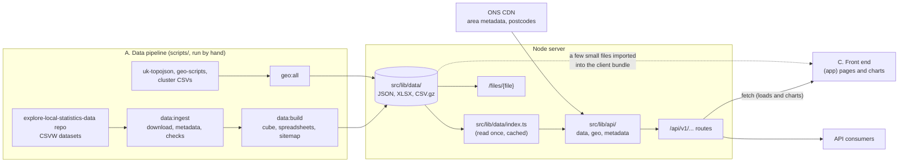

# Architecture

This document gives a high-level overview of how Explore Local Statistics (ELS) works. It is aimed
at developers who are new to the codebase. For setup and day-to-day commands, see
[README.md](../README.md). For the HTTP API's endpoints, parameters and response shapes, see
[docs/api/](./api/README.md).

- [Overview](#overview)
- [Repository layout](#repository-layout)
- [A. Data pipeline](#a-data-pipeline)
- [The data files in `src/lib/data/`](#the-data-files-in-srclibdata)
- [B. Back end and API](#b-back-end-and-api)
- [C. Front end](#c-front-end)
- [How the three parts connect](#how-the-three-parts-connect)
- [Geography levels](#geography-levels)
- [Build and deploy](#build-and-deploy)
- [Testing](#testing)

## Overview

ELS lets users find and compare statistics for UK areas (countries, regions, local authorities and
so on), through area pages, indicator pages, maps, charts and tables. The same data is available
through a public JSON/CSV/XLSX API.

The app is a SvelteKit site, deployed as a Node server. **There is no database.** Indicator data is
prepared ahead of time by a set of scripts and committed to the repo as static files, which are
bundled into the build and read into memory by the server.

The work splits fairly cleanly into three parts:

- **A. Data pipeline** (`scripts/`): downloads raw datasets, checks them, and builds the static data
  files in `src/lib/data/`. Run by a developer when data changes, never at runtime.
- **B. Back end and API** (`src/lib/api/`, `src/routes/(api)/`): reads the static data files and
  serves them, filtered and formatted, through `/api/v1/...`.
- **C. Front end** (`src/routes/(app)/`, `src/lib/components/`): the pages users see. Pages get
  their data by calling the API.



## Repository layout

```
scripts/                  # A. Data pipeline (see scripts/managing-updates.md)
├── config/               # Hand-edited inputs: manifest_metadata.csv, data-repo-version.json, clusters/, slug_changes.csv
├── util/                 # Shared helpers: CSV I/O, column lookups, period/geography inference
├── raw-data/             # Downloaded datasets (not committed)
└── *.ts                  # One script per pipeline step
src/
├── hooks.server.ts       # Logger wiring; strips overlong Link headers
├── lib/
│   ├── data/             # Generated data files + index.ts (the server-side reader)
│   ├── api/              # B. Query logic, by domain: data/, geo/, metadata/ (+ utils.ts, config.ts)
│   ├── components/       # C. charts/, modals/, nav/, visuals/
│   ├── config/           # Shared by A, B and C: geoLevels.ts, geoLookups.ts, measures, topics, nav map sources
│   ├── config.ts         # Colours, palettes and other front-end constants
│   ├── util/             # Front-end helpers: link and validation helpers
│   ├── utils.ts          # Front-end helpers: makeDataUrl, formatters, analytics wrappers
│   └── logger.ts         # pino logger
├── routes/
│   ├── (app)/            # C. User-facing pages
│   ├── (api)/            # B. /api/v1/... routes, /files/{file}, health checks
│   └── +layout.svelte    # Root layout: design-system CSS, noindex tag
└── test/mockAppServer.ts # Lets Vitest import $lib/data (see Testing)
docs/                     # This file, ANALYTICS.md, DECISIONS.md, ROADMAP.md, api/
ci/                       # Concourse pipeline tasks
```

## A. Data pipeline

The full workflow for a data update is in
[`scripts/managing-updates.md`](../scripts/managing-updates.md). This section covers what the
scripts do, not when to run them.

### Indicator data

Raw indicator data is maintained by the data team in the
[explore-local-statistics-data](https://github.com/ONSdigital/explore-local-statistics-data) repo,
one folder per dataset, each holding a CSV and a metadata JSON file.

| Step | Command                     | Script                     | What it does                                                                                                                                                                                                                             |
| ---- | --------------------------- | -------------------------- | ---------------------------------------------------------------------------------------------------------------------------------------------------------------------------------------------------------------------------------------- |
| 1    | `npm run data:download`     | `download-data.ts`         | Clones the data repo at the branch (and optionally commit) named in `scripts/config/data-repo-version.json` into `scripts/raw-data/`, and records each file's last-commit date as `timestamps.json`                                      |
| 2    | `npm run data:metadata`     | `generate-metadata.ts`     | Writes a CSVW metadata file for each dataset: maps raw column names to standard ones (`util/config.ts`), infers geographies, period format and frequency, and flags multivariate datasets                                                |
| 3    | `npm run data:checks`       | `preprocessing-checks.ts`  | Compares the incoming data with the current `json-stat-metadata.json` and the manifest, and writes `scripts/data-update-changelog.txt` for a person to review                                                                            |
| 4    | `npm run data:generate`     | `generate-data.ts`         | Builds the JSON-stat cube from every dataset marked `include` in `scripts/config/manifest_metadata.csv`, in manifest order (which is the taxonomy order). Also writes the metadata-only cube, summary stats and the areas-in-data lookup |
| 5    | `npm run data:spreadsheets` | `generate-spreadsheets.ts` | Writes the "all datasets" XLSX files (one for the UK, one per area type), CSV and CSVW, using the **back end's own** filtering and formatting code                                                                                       |
| 6    | `npm run meta:sitemap`      | `generate-sitemap.ts`      | Writes `static/sitemap.xml` from the areas list and indicator metadata                                                                                                                                                                   |

Steps 1–3 are `npm run data:ingest`, and steps 4–6 are `npm run data:build`. Between them, a person
reads the changelog and edits the manifest.

`npm run meta:redirects` (`make-redirects.ts`) turns `scripts/config/slug_changes.csv` into
`indicator_redirects.json`, so that old indicator URLs redirect to renamed ones.

### Geography data

Run separately, when boundaries or area groupings change, not on each data update.

- `npm run geo:generate` (`make-geo-data.ts`) fetches boundaries from
  [uk-topojson](https://github.com/ONSdigital/uk-topojson) and the area lookup from
  [geo-scripts](https://github.com/ONSdigital/geo-scripts), and writes `topo.json`,
  `geo-metadata.json`, `areas-list.json` and `geo-start-years.json`.
- `npm run geo:clusters` (`make-clusters.ts`) turns the CSVs in `scripts/config/clusters/` into
  `areas-clusters.json` (statistical clusters) and `areas-similar.json` (each area's nearest
  neighbours), which drive the "similar areas" features.
- `npm run geo:all` runs both.

`generate-data.ts` reads `geo-metadata.json` for area names, so run the geography scripts first if
both are needed.

## The data files in `src/lib/data/`

Everything in this folder is generated, except `index.ts` and `product-links.json` (hand-edited
links to related ONS products per area type). Treat it as read-only at runtime.

| File                                                                          | Made by             | Used by                                                        |
| ----------------------------------------------------------------------------- | ------------------- | -------------------------------------------------------------- |
| `json-stat.json` (~11 MB)                                                     | `data:generate`     | Data API; downloadable as-is from `/files/json-stat.json`      |
| `json-stat-metadata.json`                                                     | `data:generate`     | Metadata API; `data:checks` and the sitemap compare against it |
| `json-stat-summary.json`                                                      | `data:generate`     | Data API (indicator index); front end (counts, topics, years)  |
| `areas-in-data.json`                                                          | `data:generate`     | Front end (area-name lookup for charts)                        |
| `all-datasets*.xlsx`, `all-datasets.csv.gz`, `all-datasets.csv-metadata.json` | `data:spreadsheets` | Downloads, via `/files/{file}`                                 |
| `topo.json`, `geo-metadata.json`, `areas-list.json`, `geo-start-years.json`   | `geo:generate`      | Geo API; front end (area nav map, map years)                   |
| `areas-clusters.json`, `areas-similar.json`                                   | `geo:clusters`      | Geo API (`/geo/related/{code}/similar`)                        |
| `indicator_redirects.json`                                                    | `meta:redirects`    | Front end (indicator page redirects)                           |

### The JSON-stat cube

`json-stat.json` is a [JSON-stat 2.0](https://json-stat.org/) **collection**:
`{ version, class: 'collection', label, updated, link: { item: [...] } }`. Each item is one
indicator, as a JSON-stat **dataset**:

- `id`, `size` and `dimension`: always `areacd`, `period` and `measure`, plus any extra dimensions
  for multivariate indicators (for example age and sex). `measure` is always last and holds `value`
  plus any interval columns (`lci`, `uci`).
- `value` (and `status` where present): a flat array laid out by the dimensions, as JSON-stat
  specifies. It is sparse, so not every combination has a value.
- `extension`: ELS-specific metadata, including `slug`, `topic`, `subTopic`, `dataset`, `code`,
  `isMultivariate`, `periodFormat`, `frequency`, `decimalPlaces`, `geography` (levels, countries and
  boundary year), `source`, and data/metadata modified dates.

`json-stat-metadata.json` is the same cube with every `value` emptied, so metadata routes don't need
the full cube. `json-stat-summary.json` holds counts, topics, years, dimension summaries and
`indicatorLookup` (slug → index into `link.item`), which the data API uses to find a named
indicator without scanning.

The manifest (`scripts/config/manifest_metadata.csv`: `slug, topic, subTopic, dataset, code,
include`) decides which indicators are in the cube, their order, and their place in the taxonomy.

## B. Back end and API

### Reading the data

`src/lib/data/index.ts` is a small reader that works in two environments. Under Vite (dev server
and the built app) it finds files with `import.meta.glob` and reads them with SvelteKit's
`$app/server` `read()`. Under plain Node (scripts) it reads them from disk. Either way, each file is
parsed once per server process and cached, so the 11 MB cube is held in memory rather than read on
each request. The cache is shared by every request, so code must never change what it returns.

The `/files/{file}` route serves these files for download (gzipped CSV is sent with
`Content-Encoding: gzip`). It also ensures that the data files are included in the build.

### The query layer: `src/lib/api/`

Organised by domain. Each `getX.ts` file is a public entry point; `helpers/` holds internal
filtering and formatting.

- `data/`: filter the cube and format the result. `getFilteredData.ts` → `filterIndicators.ts`
  (which indicators) → `filterDatasets.ts` (which areas, periods and other dimension values) →
  `helpers/dataFormatters.ts` (`cols.json`, `rows.json`, `json`) or `generateCSV.ts`,
  `generateCSVW.ts`, `generateXLSX.ts`.
- `geo/`: area lookups by code, name, postcode and coordinates; parents, children, siblings and
  similar areas; boundaries. Most of this uses the bundled geography files, but area metadata,
  coordinate lookups and postcode lookups are fetched at request time from the ONS CDN (base URLs in
  `src/lib/api/config.ts`).
- `metadata/`: indicator metadata, dimension values and the topic taxonomy.
- `utils.ts`: query-parameter parsing (`getParam`) and validation (`hasValidParams`). `config.ts`:
  allowed formats and parameters per route.

### Routes: `src/routes/(api)/`

Route handlers are thin: they validate query parameters and call into `src/lib/api/`. The data
endpoint has two routes: `/api/v1/data.{format}` (any number of indicators, always grouped by
indicator) and `/api/v1/data/{indicator}.{format}` (one indicator, never grouped). The full
reference is in [docs/api/](./api/README.md).

There are also operational routes: `/api/health` (status and git commit), `/api/alive`, and
`/api/exception` (throws on purpose, to test error logging).

`src/hooks.server.ts` sends `console.*` to the pino logger outside dev, and removes overlong `Link`
headers that nginx would reject.

## C. Front end

### Pages: `src/routes/(app)/`

| Route                      | Page                                                                                                                               | Main data loaded (all via `/api/v1/...`)                              |
| -------------------------- | ---------------------------------------------------------------------------------------------------------------------------------- | --------------------------------------------------------------------- |
| `/`                        | Home: area search, links to indicators, "download all" links                                                                       | none (summary stats from the layout)                                  |
| `/areas/search`            | Area search results, by name or postcode                                                                                           | `geo/search`, `geo/postcodes`                                         |
| `/areas/[code]`            | Area page: summary, nav map, child areas, link to its indicators. Redirects to the canonical `code-name` slug (`E07000178-oxford`) | `geo/lookup/{code}`                                                   |
| `/areas/[code]/indicators` | Every indicator for one area, compared with chosen areas, as beeswarms or sparklines                                               | `metadata/taxonomy`, `metadata/indicators`, `geo/list`, `geo/related` |
| `/indicators`              | Indicator list by topic, with search                                                                                               | `metadata/taxonomy`                                                   |
| `/indicators/[code]`       | One indicator: map, line, bar and table charts, downloads. Redirects renamed slugs                                                 | `metadata/indicators/{code}`, `geo/list`                              |
| `/indicators/[code]/embed` | One chart on its own, for embedding with pym.js. Uses the root layout only (`+page@.svelte`)                                       | `metadata/indicators/{code}`                                          |

`(app)/+layout.svelte` adds the ONS header, breadcrumbs, footer, page `<head>` metadata and
analytics. Each page's `load` returns `title`, `description`, `pageType` and breadcrumbs for it to
use.

`load` functions are universal (`+page.ts`), and call the API with SvelteKit's `fetch`. During
server rendering SvelteKit handles these requests in the same process, without a network round
trip. In the browser they are ordinary HTTP requests.

### Charts

Chart data is always fetched in the browser, in `cols.json` format:

1. A page or `IndicatorChart.svelte` builds the URL with `makeDataUrl()` (`src/lib/utils.ts`). Only the
   download links on `indicators/[code]/+page.svelte` build data URLs by hand. A plain-string `indicator` gives the single-indicator
   route; an array gives the multi-indicator route.
2. `ChartDataLoader.svelte` fetches it when the chart becomes visible, treats an empty result as "no
   data", and optionally drops outlier areas listed in `extremeAreas` (`src/lib/config.ts`).
3. The chart component (`charts/Line`, `Bar`, `Map`, `Table`, `Beeswarm`, `Sparkline`, `Pyramid`)
   draws it.

`ChartActions.svelte` provides the download links (the same URL with another format), PNG export
(snapdom) and embed code.

### Components and libraries

- `src/lib/components/`: `charts/`, `modals/` (area and chart-option pickers), `nav/` (area and
  indicator search, pagination), `visuals/` (maps and spinner). Components used by only one page sit
  next to that page in `src/routes/(app)/`.
- UI is built with `@onsvisual/svelte-components`, the Svelte port of the ONS Design System; see the
  README for working against a local copy. Maps use MapLibre, with styles in `static/data/` and
  boundaries from `/api/v1/geo/boundaries.topojson`.
- A few small data files are imported straight into the client bundle rather than fetched:
  `json-stat-summary.json`, `areas-in-data.json`, `geo-latest-year.json`, `geo-start-years.json`,
  `indicator_redirects.json` and `product-links.json`. `topo.json` (~700 KB) is imported by the area
  nav map (`areas/[code]/AreaNavMap.svelte`).
- Analytics events are listed in [ANALYTICS.md](./ANALYTICS.md).

## How the three parts connect

These are the places where a change in one part can break another.

- **A → B: the data files.** The back end assumes the cube's shape described above (dimension
  order, `measure` last, the `extension` fields, `indicatorLookup`). A change to `generate-data.ts`
  output must be checked against `src/lib/api/data/`.
- **B → A: the spreadsheet script uses back-end code.** `generate-spreadsheets.ts` imports
  `filterIndicators`, `filterDatasets`, `generateXLSX` and `generateCSV` from `src/lib/api/data/`, so
  the downloadable files match the API's output. A change to those functions changes the next
  `data:build`.
- **Shared config.** `src/lib/config/geoLevels.ts` is imported by the pipeline scripts, the API and
  the front end.
- **B → C: the HTTP API.** The front end gets its data only through `/api/v1/...` and `/files/...`.
  It also imports a few pure helpers from `src/lib/api/` (area slug helpers, `getParam`, the
  allowed-format lists, `geoYearFilter`, `timeRangesOverlap`), and a few small data files (listed
  above). A change to an API response shape needs a matching change in the pages or charts that use
  it; `makeDataUrl` and `ChartDataLoader` are the main places.

## Geography levels

`src/lib/config/geoLevels.ts` defines several groupings of area types (by GSS code prefix), for
different jobs:

- `geoLevels`: the levels data is shown at (`ctry`, `rgn`, `cauth`, `utla`, `ltla`). These are also
  the areas with indicator pages.
- `geoLevelsNav`: the levels used to browse between areas, down to output areas.
- `geoLevelsIndexed`: area types search engines may index.
- `geoLevelsNamed` and `geoLevelsAll`: mutually exclusive types for search and selection.

The API's `geoLevel` parameters accept different sets of values on different routes as a result,
which is covered in [docs/api/important-notes.md](./api/important-notes.md).

## Build and deploy

- **Adapter.** `svelte.config.js` uses the Vercel adapter when the `VERCEL` environment variable is
  set (preview deployments of pushed branches, used for review and data QA) and the Node adapter otherwise
  (production).
- **Production.** A Docker image (`Dockerfile`, which calls `make build-builder`) running
  `node build` on port 3000, under the base path `/explore-local-statistics`. Concourse runs the
  `ci/` tasks (audit, unit tests, build; lint is currently a no-op), and the job is deployed with
  Nomad (`explore-local-statistics.nomad`). The production site sits behind Cloudflare.
- **Environment variables.** `SVELTEKIT_BASE_PATH`, `SVELTEKIT_ASSETS_PATH` and
  `SVELTEKIT_APP_VERSION` set the base path, asset path and version (see `Makefile`). Assets are served
  from the container. Serving them from a CDN bucket (`ENABLE_S3_ASSETS`) is switched off for good
  and due to be removed; the reasoning is in [DECISIONS.md](./DECISIONS.md#build-and-deploy).
- **Logging.** Outside dev, `console.*` goes through pino (`src/lib/logger.ts`). Production builds
  also mark `console.log` and similar calls as removable (`vite.config.ts`).

## Testing

- `npm run check` (svelte-check) and `npm run lint` (Prettier and ESLint) are the main checks.
- `npm run test:bench` runs Vitest benchmarks for the data API (`src/lib/api/data/**/*.bench.ts`),
  against request shapes taken from real pages (`__fixtures__/queryShapes.ts`).
  `src/test/mockAppServer.ts` stands in for `$app/server`'s `read()`, so `$lib/data` can be imported
  under plain Vitest. It reads the source files, so it only works before a build.
- `npm run test:unit` and `npm run test:integration` exist, but currently only run placeholders
  (`src/index.test.ts`, and the SvelteKit starter test in `tests/test.ts`, which would fail against
  this app). Adding real tests is in [ROADMAP.md](./ROADMAP.md).
